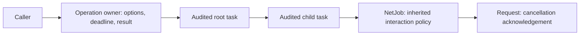

# Unattended task execution

Status: proposed; implementation deferred at the Round 1 size gate.
Inspected baseline: `bb2af1db4ebe4256737e349731b166d9bdb51c8f`.
This note does not claim upstream acceptance or close HANDOFF findings 1 or 2.

## Requirements and decision

An unattended operation must have a bounded response time, preserve CLI JSON and
exit codes, prevent prompts in its task tree, and retain ownership until work
actually stops. An unrelated GUI operation must keep its interaction policy.
Qt network requests still require event delivery; a terminal value does not
make async I/O safe to block.

Use explicit task options and structured results, carried through the existing
Task/composite APIs. Do not use ambient thread-local or process-global state.
Only tasks audited for the contract may be submitted as unattended operations;
an unsupported task is rejected before starting, with an error value. This
capability check is necessary: Task cannot prevent a subclass from opening a
QDialog directly. Imports need their own adapters before they can participate.

## Interaction policy

Use `InteractionPolicy { Interactive, Unattended }` in task execution options.
The caller supplies Unattended when adopting an inactive root; ordinary GUI
callers retain Interactive. Options are fixed before start. Reject attaching a
running task with conflicting options; never silently repolicy existing GUI work.
Composite adoption propagates options to already queued descendants, and to
children added later, before starting them. Propagation must be transitive:
setting the root flag alone is insufficient. Adopted children cannot loosen the
policy. Provider factories must return inactive jobs, or accept options before
starting any work. Constructors must not prompt, launch work, or publish failure.

NetJob checks its effective policy at the point where it would open a retry
dialog: Unattended always suppresses interaction, even after `setAskRetry(true)`.
`setAskRetry` remains an interactive preference, separate from the operation
policy; automatic bounded network retries remain available. Remove
`defaultAskRetry`, `setDefaultAskRetry`, their Application bracket, and the
`isHeadlessRun()` branch only after callers have explicit propagation. Other CLI
commands remain legacy until ported; removing their existing protection early
would regress them. A mixed migration therefore cannot honestly eliminate the
global workaround for every command in this round without additional coverage.

## Deadline, cancellation, and ownership

`Task::finished` currently reports logical completion; it does not consistently
prove that children stopped. Strengthen that contract for participating tasks:
terminal completion acknowledges that no owned child, queued start, request,
worker, or task callback can subsequently write files or touch the model.
Composite cancellation clears queued work, prevents new descendants and retries,
requests cancellation of active children, and waits for every acknowledgement.
A failed abort request is not a completion acknowledgement.

The operation owner holds the root and any required instance/model lifetime
lease. A deadline records Timeout exactly once and requests cancellation.
For synchronous use it returns only after cancellation is acknowledged; a task
without a bounded cancellation guarantee must be rejected before start. A grace
period is a diagnostic bound, not permission to destroy a running task or release
its model. The current Task API cannot provide this guarantee for arbitrary tasks.

If asynchronous callers need a response at the deadline even when cancellation
cannot finish, the operation owner must remain registered with the caller's
existing lifetime owner, retaining the task tree and the instance mutation lease.
The command is still busy until quiescence, and instance removal/conflicting
mutations must remain blocked. Later completion releases leases and schedules
task destruction through the existing deferred QObject deleter. It cannot emit a
second result. Shutdown must drain or explicitly terminate this work before
tearing down models. This is an alternative API, not a detached reaper list.

For the first port prefer bounded cancellation and reject unsupported trees;
do not introduce a registry of background operations merely to return sooner.
Neither dropping a shared pointer nor disconnecting progress handlers cancels
network, filesystem, or model callbacks. Previously committed file writes remain;
this contract guarantees cessation, not rollback or atomic multi-file installation.

## Failure values

Return `Result<void, TaskFailure>`, where TaskFailure contains an enum code and
QString message. Initial codes: InvalidTask, UnsupportedTask, Failed, Cancelled,
Timeout. A failure from legacy `emitFailed(QString)` maps to Failed without
interpreting its text. More specific errors require producers to supply codes.
Completion after a deadline still yields Timeout, including success during
cancellation. No sentinel-string or translated-message matching is permitted.

The CLI boundary maps these codes to its existing envelopes and exit codes;
command-specific Failed becomes `download_failed`/Network for mod downloads.
Preserve existing timeout/unfinished-operation public codes with explicit mapping
where applicable. Metadata project-not-found handling also needs a typed HTTP
status from its producer: porting just the final download leaves string parsing
in the current `fetchProject` path and is not an end-to-end port.

## Implementation boundary and alternatives

The honest implementation exceeds the requested approximately 200-line shared
code ceiling. Estimated changed shared lines (planning estimates, not a patch):
Task options/capability/error contract 80–120; composite propagation, cancellation
and terminal acknowledgement 100–150; NetJob policy and abort repair 40–60.
That is roughly 220–330 lines before producer audits, tests, or CLI changes.

Concrete blockers found in this tree:

- ConcurrentTask abort emits finished with no state transition when no child is
  active, and can report failure while a child could not be aborted.
- SequentialTask failure immediately finishes its parent; it needs cancellation
  and draining semantics rather than relying on the parent's finished signal.
- NetJob abort can receive synchronous child terminal signals while iterating;
  its completion must be coordinated with the composite state machine.
- ResourceDownloadTask creates children in its constructor, stores a raw model
  pointer, and has download callbacks that mutate that model. It also connects
  failure directly in addition to SequentialTask's failure propagation.
- GetModDependenciesTask adds further provider jobs inside success callbacks;
  propagation must cover these late children, not just the initial queue.

ResourceDownloadTask and GetModDependenciesTask live outside this round's allowed
shared paths. An end-to-end port also touches provider error production and
profile preparation. These require an explicit scope decision.

Recommended next round: authorize the bounded, audited Task/composite contract
and the mod-install producer files, then port only mod install. Retain legacy
protection for unported commands and track its eventual removal separately.
Alternative: a CLI-only download operation with explicit NetJob policy and no
model callbacks can be smaller, but duplicates installation/dependency logic and
does not repair the shared task contract. Rejected: a global retry flag, a scoped
thread-local flag around a nested event loop (GUI reentrancy inherits it), a
process-lifetime reaper, deleting unfinished tasks, and treating abort's bool or
finished alone as proof of quiescence. Moving the nested loop into a new class
does not resolve sync-over-async or ownership.

## Baseline verification (2026-11-13)

`./containers/spike-build.sh build`: PASS; test: 37/37 PASS (18.85 seconds).
Each smoke ran in `prism-spike-dev` with `/repo` mounted, HOME=/tmp and
QT_QPA_PLATFORM=offscreen, using the invocation in the Round 1 task.
All scripts exited 1: mod smoke at `mod install` (exit 134), pack smoke at
`resource install` (134), instance smoke at `version install-loader` (134).
Each logged a ComponentUpdateTask metadata-load failure followed by the
`Task::emitFailed` running-state assertion at Task.cpp:122; no JSON error was
returned by the crashing command. Refresh causality and the exact duplicate
completion source are unproven; no speculative fix was made. Network smoke
failures are separate from the green offline suite. Both HANDOFF findings remain
open; Steps 2 and 3 await the scope decision described above.
