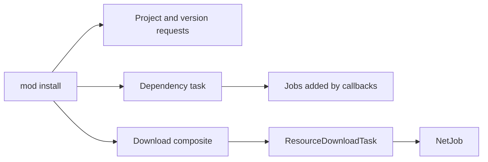

# Unattended task execution

Status: reduced contract implemented locally after independent design review.
This is an incremental CLI spike, not a claim of upstream acceptance.
R2 corrections await another independent review; see [the finding map](R2-REVIEW-FIXES.md).

## Contract and scope

A caller marks an inactive Task with `setUnattended(true)` before starting it.
The flag belongs to that task tree; no thread-local or process-wide interaction
context is introduced. A running task rejects a change to its policy. Callers
must check the return value when adopting tasks that might already be running.

ConcurrentTask propagates the flag to queued children when its policy changes,
to children added later, and again before starting a child. Propagation through
nested composites includes jobs created inside dependency-resolution callbacks.
An incompatible running child is recorded as failed without being cancelled.
The parent reports PolicyConflict after its owned active work has stopped. Failed policy changes can leave inactive
children already configured; the caller must not start a rejected operation.

NetJob's effective `asksRetry()` is false when unattended, including after an
explicit `setAskRetry(true)` and for jobs created before adoption. The failure
path uses the tested `shouldAskRetry(headlessRun)` predicate. The headless-process
fallback also remains until legacy job creation is migrated. Automatic
bounded retries still run; only the interactive retry decision is suppressed.
Adoption does not change an existing unrelated task's flag or retry preference.

The old `setDefaultAskRetry` bracket in Application remains for unported CLI
commands. It still changes constructor defaults process-wide while a command
runs. Therefore this change does not yet close HANDOFF finding 2 globally.
The new flag overrides explicit retry preferences in adopted trees; the legacy
bracket alone cannot provide that guarantee for unported trees.

This flag guards NetJob interaction, not arbitrary QDialog calls in subclasses.
Imports and other command groups have not been comprehensively ported. Shared
profile preparation remains on its existing launcher path. ModFolderModel has
an explicit unattended toggle overload: it rejects running-instance mutations,
skips dependency confirmation, and toggles only the supplied selection. CLI
recursive toggles expand that selection themselves. GUI callers retain prompts.

## Cancellation and ownership

Task terminal notifications are idempotent: after success, failure or abortion,
later terminal notifications log a warning without changing the result or
emitting another finished signal. Finishing an inactive task remains a bug:
it asserts in Debug builds and logs/rejects the transition in Release builds.
A restart resets the failure code and message.

ConcurrentTask abort clears queued work, snapshots active children, and requests
cancellation without iterating a container that callbacks mutate. Queued starts
are checked again before execution. A shared child already started by another
composite is observed rather than started twice.

Inactive or terminal ConcurrentTask abort calls return true without changing
state or queued work and without emitting signals. A running composite finishes
cancellation only after its active set is empty.
An abort returning false records failure but does not release a still-running
child. Synchronous terminal callbacks cannot finish the parent before all abort
requests have returned. MultipleOptionsTask suppresses queued advancement while
cancelling. SequentialTask has one active child and records its completion before
failing; it needs no separate drain API. A waiting launch wrapper cancels itself
without starting its inactive child and ignores a later proceed call.

NetJob inherits this same cancellation path directly. Child aborted handlers are disconnected
while finished acknowledgements are observed. An abort failure uses Task's
noninteractive failure emitter, bypassing NetJob's retry-dialog override. An
idle running job also transitions to a terminal state when aborted. Audited
wrappers acknowledge idle cancellation or forward a child completion; accepting
an abort request alone is not a terminal acknowledgement. An unsupported child
that never acknowledges completion remains retained after the runner deadline.

Cli::runTaskSync still delivers Qt events through a local nested event loop.
At its deadline it requests abort and waits for the existing grace period.
A task that stops during that period returns Timeout, regardless of its own
terminal reason. If it is still running after the grace period, the runner returns Incomplete and
retains it in `unfinishedTasks()`. The list releases the task when finished arrives, using
the existing deferred QObject deleter. Its completion connection captures a raw
identity, not another owning reference, so it cannot keep itself alive forever.

The list owns tasks, not instances or models. A noncooperative task can still
write files or touch a raw instance/model pointer after the command returns.
Other Task subclasses may also have weaker finished/cancellation semantics than
ConcurrentTask. GUI reentrancy and conflicting mutations remain possible during
the nested loop. HANDOFF finding 1 therefore remains open despite the composite
cancellation and completed-task cleanup fixes. No rollback or atomic installation
is promised. A task that never finishes stays retained until process exit.

## Failure values and the first command port

Task stores a FailureCode beside its message. Base failure/abort emitters set
Failed/Cancelled, and success clears the code. The protected typed emitter is
used for composite propagation and PolicyConflict. A lone child failure retains
its code through ConcurrentTask or SequentialTask; aggregate failures stay Failed.
Legacy emitters that bypass these paths may be uncoded; composites treat that as
Failed. The CLI currently originates Timeout, InvalidTask, NotFound and Incomplete.
Its runner returns `Result<void, TaskError>` with the observed code and message.

The CLI's typed mapping helpers examine codes, never translated text or sentinel
strings. They map Incomplete to `operation_did_not_finish` and exit 1, including
project/version metadata and download failures in mod install.
PolicyConflict maps to `task_policy_conflict` and exit 1. A failure whose message
happens to equal an error-code string remains an ordinary failure. No CLI command
classifies errors by translated message text. Other command-specific mappings
and public JSON shapes are preserved.

Mod install marks its project/version requests, dependency tree and download
tree unattended. Typed metadata helpers return NotFound from HTTP status 404;
all metadata callers now use typed results rather than searching messages. Version-response
callbacks hold shared result storage so a timeout cannot leave a stack reference.
The download phase emits one error envelope and returns immediately on failure:
ordinary download failure maps to `download_failed` and exit 7. ResourceDownloadTask
lets SequentialTask report a child failure once instead of emitting it twice.

## Alternatives and verification

A global retry switch cannot isolate unrelated GUI jobs or override explicit
preferences. A thread-local scope around a nested loop also leaks policy into
reentrant GUI work. Deleting a running task is unsafe, and renaming the local
loop would not solve sync-over-async. This reduced change deliberately retains
the existing runner and timeout list; a fuller execution redesign is future work.

Regression tests cover duplicate terminal emissions, queued and active aborts,
refused and delayed cancellation, shared loaders, late-grandchild policy,
explicit retry override, typed error mapping, and deferred timeout cleanup.
The mod-install download-phase test uses an in-memory failing request with the
real NetJob/composite runner, checks exit 7 and exactly one JSON envelope, and
bounds completion to one second against a ten-second operation deadline without
external network access. Model-toggle coverage supplies a real dependency
relationship and verifies the unattended path preserves the unselected dependent.
An isolated subprocess checks inactive-task emission rejection. The prompt-policy
predicate is tested with pre-existing headless and unattended jobs. A loopback-only
metadata failure test covers the earlier refresh failure that aborts Debug builds.
Whole-command success paths are exercised separately by the three network smokes.

Verification on the implementation: container build PASS; CTest 37/37 PASS;
network mod, pack and instance smoke scripts each PASS.
